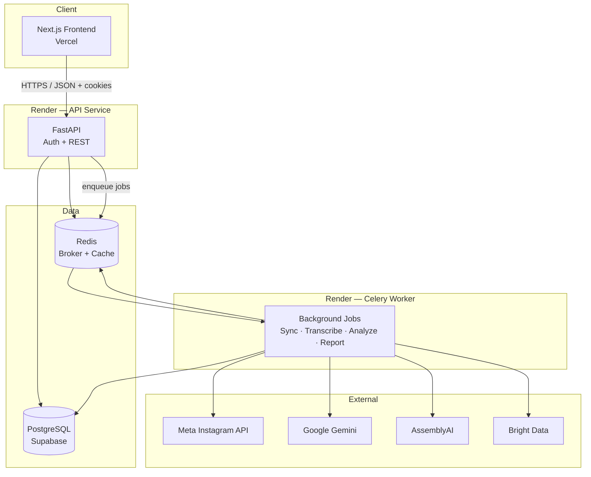
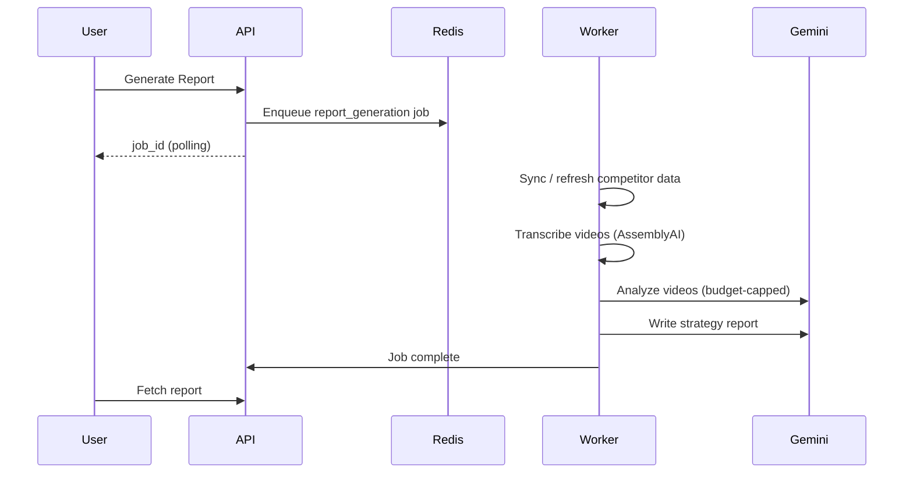

# Reelysis — Instagram AI Content Growth Analyzer

**Reelysis** is a full-stack web application that helps Instagram creators understand why their Reels are or are not growing. It connects to a user's Instagram account, imports Reel performance data, discovers niche competitors, runs transcript-first AI analysis, and produces actionable content strategy reports.

> Built as a solo full-stack project: product spec → architecture → implementation → production deployment.

---

## Live links


| Resource     | URL                                                           |
| ------------ | ------------------------------------------------------------- |
| **Live app** | [reelysis-zeta.vercel.app](https://reelysis-zeta.vercel.app/) |
| **API**      | Render (private URL)                                          |
| **Contact**  | [bonsonalo@gmail.com](mailto:bonsonalo@gmail.com)             |


---


## Problem

Creators see views and likes in Instagram Insights, but not *why* content works or fails. Manual competitor research and content audits are slow and inconsistent.

**Reelysis solves this by:**

- Importing the user's Reels and performance metrics via Meta OAuth
- Discovering similar creators in the same niche (AI-suggested handles + public data)
- Transcribing and analyzing video content with Google Gemini
- Generating a comparative strategy report with gaps, strengths, and next-post recommendations

---


## Architecture




### Services


| Layer         | Stack                                                | Role                                                          |
| ------------- | ---------------------------------------------------- | ------------------------------------------------------------- |
| Frontend      | Next.js 16, TypeScript, React Query, Redux, Tailwind | Dashboard, onboarding, reports, video analysis UI             |
| API           | FastAPI, SQLAlchemy (async), Alembic                 | Auth, Instagram OAuth, job triggers, data APIs                |
| Worker        | Celery, Redis                                        | Instagram sync, transcription, AI analysis, report generation |
| Database      | PostgreSQL (Supabase)                                | Users, accounts, media, metrics, analysis jobs, reports       |
| Cache / queue | Redis                                                | Celery broker, OAuth state, rate limits, Gemini daily budget  |


---


## Key features

- **Authentication** — Email/password signup, JWT access + refresh tokens, HttpOnly cookies (`SameSite=None` for cross-origin Vercel ↔ Render)
- **Instagram connection** — Meta OAuth for Business/Creator accounts; Reel import with captions, hashtags, and insights
- **Onboarding flow** — Niche confirmation → AI competitor suggestions → strategy report generation
- **Dashboard** — Reel cards, growth metrics, content pillars, processing status
- **Competitor intelligence** — Auto-discovery via Gemini + public profile scraping; manual handle tracking
- **AI pipeline** — AssemblyAI transcription → Gemini transcript-first analysis (hooks, topics, pillars)
- **Reports** — Comparative strategy document with prioritized recommendations and progress tracking
- **Production ops** — Alembic migrations, Render blueprint (`render.yaml`), Supabase pooler compatibility, stale-job reconciliation

---


## Tech stack

**Frontend:** Next.js (App Router), TypeScript, TanStack React Query, Redux Toolkit, Tailwind CSS, shadcn/ui, Recharts

**Backend:** Python 3.12, FastAPI, SQLAlchemy, Alembic, Celery, Redis, bcrypt, JWT

**Infrastructure:** Vercel (frontend), Render (API + worker), Supabase (Postgres), Render Redis

**Integrations:** Meta Instagram Graph API, Google Gemini, AssemblyAI, Bright Data

---


## Screenshots


### Landing page (hero)

Landing page

### Dashboard

Dashboard

### Competitors

Competitors page

### Video analysis

Video analysis

### Strategy report

Report

---


## Project structure

```
insta/
├── frontend/          # Next.js app (Vercel)
├── backend/
│   ├── app/
│   │   ├── api/       # FastAPI routers (~34 endpoints)
│   │   ├── core/      # Config, DB, Redis, external clients
│   │   ├── model/     # SQLAlchemy models
│   │   ├── service/   # Business logic
│   │   └── schema/    # Pydantic schemas
│   ├── alembic/       # Database migrations
│   └── scripts/       # Migrations, worker, deploy helpers
├── render.yaml        # Render service blueprint
└── docs/screenshots/  # README screenshots
```

---


## Background job pipeline




Job types: `instagram_sync`, `competitor_discovery`, `transcription`, `video_analysis`, `report_generation`

---


## Production challenges solved

These are real issues debugged during deployment — useful context for technical interviews:


| Issue                                         | Root cause                                                                               | Fix                                                                                         |
| --------------------------------------------- | ---------------------------------------------------------------------------------------- | ------------------------------------------------------------------------------------------- |
| `Network is unreachable` to Supabase          | Render cannot reach IPv6-only direct DB hosts                                            | Switched to Supabase **Session pooler** (IPv4-friendly hostname)                            |
| `ModuleNotFoundError: psycopg2`               | `postgresql://` URL made SQLAlchemy pick wrong driver                                    | Centralized URL normalization (`postgresql+asyncpg://`, `postgresql+psycopg://`)            |
| `DuplicatePreparedStatementError`             | Transaction pooler (port 6543) / PgBouncer incompatible with asyncpg prepared statements | Disabled statement cache, `NullPool`, `query_cache_size=0` on pooler connections            |
| Report jobs stuck at `running`, `progress: 0` | Worker DB errors left transactions aborted; no early progress signal                     | `rollback()` before failure updates; `progress: 2` on task start; faster stale-job timeouts |
| ~10s login / signup / refresh                 | `NullPool` + new TCP+TLS per query, bcrypt on throttled CPU, remote DB latency           | Documented tradeoff; session pooler (5432) improves connection reuse                        |
| Growth chart empty / 100% deltas              | Only one day of snapshot data after first sync                                           | Expected behavior until a second sync day exists                                            |


---


## Local development


### Prerequisites

- Python 3.12+
- Node.js 20+
- PostgreSQL (or Supabase dev URL)
- Redis


### Backend

```bash
cd backend
python -m venv .venv
source .venv/bin/activate
pip install -r requirements.txt
cp .env.example .env   # fill DB_URL, REDIS_URL, API keys
python scripts/run_migrations.py
uvicorn app.main:app --reload
```


### Worker

```bash
cd backend
bash scripts/worker.sh
```


### Frontend

```bash
cd frontend
pnpm install
cp .env.local.example .env.local   # set NEXT_PUBLIC_API_URL
pnpm dev
```

---


## Environment variables (overview)


| Variable                         | Purpose                               |
| -------------------------------- | ------------------------------------- |
| `DB_URL`                         | Supabase PostgreSQL connection string |
| `REDIS_URL`                      | Celery broker + app cache             |
| `JWT_SECRET`                     | Access / refresh token signing        |
| `META_APP_ID`, `META_APP_SECRET` | Instagram OAuth                       |
| `GEMINI_API_KEY`                 | AI analysis and reports               |
| `ASSEMBLYAI_API_KEY`             | Video transcription                   |
| `BRIGHT_DATA_*`                  | Competitor public data                |
| `FRONTEND_URL`, `CORS_ORIGINS`   | Cross-origin config                   |


See `backend/app/core/config.py` for the full list.

---


## Author

**Bonson Alo** — Computer Science student, Albukhary International University, Malaysia

- GitHub: [@bonsonalo](https://github.com/bonsonalo)
- LinkedIn: [linkedin.com/in/bonsonalo](https://linkedin.com/in/bonsonalo)
- Instagram: [@bonsonalo](https://instagram.com/bonsonalo)
- YouTube: [@BonsonDev](https://youtube.com/@BonsonDev)

---


## License

Private / portfolio project. Contact for collaboration inquiries.