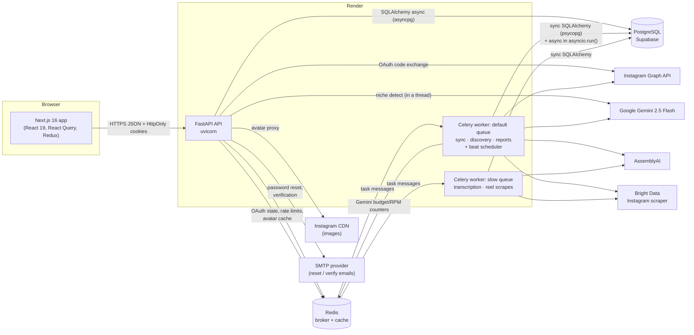

# Reelysis — System Architecture

> How the pieces fit together, and *why* they were built this way.

---

## 1. The big picture



### Simple explanation

Think of it as a restaurant:

- The **frontend** is the dining room — it shows menus and takes orders.
- The **API** is the waiter — it takes the order, checks you are a real customer (auth), writes a ticket (**job row in Postgres**), and pins it to the kitchen rail (**Redis queue**). It immediately tells you "your order number is X" (`job_id`).
- The **Celery workers** are the kitchen — two cooks: one for quick orders (sync, competitor discovery, reports) and one for slow ones (transcription, scraping competitor reels), so a slow dish never holds up a quick one. Each updates the ticket's progress as it goes — and every update is also a "still alive" heartbeat.
- A **timer** in the kitchen (Celery beat) queues a daily re-sync for every account and renews Instagram access before it expires.
- The frontend **polls** "how's order X?" every couple of seconds (`GET /analysis/jobs/{id}`) until it says `succeeded` or `failed`.

Anything that can take more than a second or two (sync, discovery, transcription, analysis, reports) goes through the kitchen. The waiter never cooks.

---

## 2. Components

### 2.1 Frontend — `frontend/`
- **Next.js 16 App Router**, React 19, TypeScript, Tailwind v4, shadcn/ui (Radix), Recharts, react-markdown.
- **Server state** (anything that comes from the API) → **TanStack React Query**: caching, refetching, polling with `refetchInterval`.
- **Client state** (UI-only: auth flag/user, sidebar open) → **Redux Toolkit**.
- **HTTP** → one axios instance (`src/lib/axios.ts`) with `baseURL = NEXT_PUBLIC_API_URL` and `withCredentials: true` so cookies flow cross-origin.
- Feature-sliced folders: `src/features/<feature>/{api.ts, hooks/, components/}`.

### 2.2 API — `backend/app/`
Layered ("controller → service → model"):

```
api/v1/endpoints/*.py   ← HTTP: parse request, auth dependency, rate limit, map errors to status codes
service/*.py            ← business logic + Celery task definitions
model/*.py              ← SQLModel tables (ORM)
schema/*.py             ← Pydantic request/response + AI output schemas
core/                   ← config, DB engines, Redis, Celery app, cookies, rate limiter, external API clients
utils/                  ← pure helpers (scoring, hashtags, time, CDN image cache)
```

Key building blocks:
- `core/config.py` — `pydantic-settings` loads and validates `.env`.
- `core/database.py` — **two engines**: async (`asyncpg`) for FastAPI, sync (`psycopg` v3) for Celery tasks and Alembic.
- `core/db_url.py` — normalises Supabase URLs (driver prefix, SSL params, PgBouncer compatibility).
- `api/dep.py` — `decode_token` (PyJWT, raises `ValueError` on any problem) and `get_current_user`, which reads the `access_token` cookie. Injected via `Annotated[..., Depends(...)]`.
- `api/errors.py` — `internal_error()` logs the traceback and returns a generic 500.
- `core/rate_limit.py` — slowapi limiter backed by Redis, keyed by IP (proxy-aware) or user id.
- `core/middleware.py` — CSRF origin check for state-changing requests.
- `core/email.py` — SMTP sender for reset/verification emails (logs the email in development when SMTP is unset).
- `service/job_utils.py` — progress heartbeats, status helpers and the shared stale-job reconciler.

### 2.3 Worker — Celery
- App defined in `core/celery_app.py`; broker **and** result backend = Redis.
- Tasks live *inside the service modules* (`@celery_app.task(name=...)`) and are dispatched by **name** with `celery_app.send_task("app.service....")` — the API never imports the task function directly, avoiding circular imports.
- Settings: JSON serialiser, UTC, `task_track_started`, 1-hour hard time limit, `worker_prefetch_multiplier=1`.
- **Two queues** (`task_routes`): `default` and `slow`. `scripts/worker.sh` starts one solo-pool process per queue, with **Celery beat** embedded in the default worker. `WORKER_MODE=single` runs one process for both queues (half the RAM, but long tasks block short ones again).

| Task name | Queue | Triggered by | Does |
|---|---|---|---|
| `instagram_service.sync_instagram_data_task` | default | `POST /instagram/sync`, scheduler | refresh token if expiring → profile + Reels (paginated) + insights → DB; niche detection; enqueues transcription |
| `competitor_service.poll_competitor_results_task` | default | niche confirm / `POST /competitors/discover` | Gemini handles → Bright Data profiles → save competitors; enqueues reels batch |
| `competitor_service.fetch_competitor_media_batch_task` | slow | end of discovery | Bright Data reels for top 5 → upsert; enqueue transcription |
| `competitor_service.fetch_competitor_media_task` | slow | `POST /competitors/` (manual add) | profile + reels for one competitor; enqueue transcription |
| `transcript_service.run_transcription_task` | slow | after sync / media fetch | AssemblyAI for every untranscribed video |
| `video_analysis_service.run_video_analysis_task` | default | (registered; the report task runs analysis inline) | Gemini per video |
| `report_service.generate_report_task` | default | `POST /reports/generate` | refresh competitors if stale → transcribe → analyse (budget-capped) → Gemini report → save |
| `scheduled_service.enqueue_due_syncs_task` | default (beat, hourly at :15) | Celery beat | queue syncs for accounts not synced in `AUTO_SYNC_INTERVAL_HOURS` (max 25/run) |
| `scheduled_service.refresh_expiring_tokens_task` | default (beat, daily 03:00 UTC) | Celery beat | extend Instagram tokens expiring within 10 days; flag dead ones for reconnect |

### 2.4 Data stores
- **PostgreSQL** — all business data + the `analysis_jobs` progress table. See `DATA_MODEL.md`.
- **Redis** — Celery queue, OAuth `state`, Gemini daily/minute counters, competitor-handle cache, avatar bytes cache, rate-limit counters.

### 2.5 External services
| Service | Used for | Call style |
|---|---|---|
| Instagram Graph API (`graph.instagram.com`) | OAuth, profile, media list, per-media insights | httpx, sync request/response |
| Gemini (`google-genai`) | niche detection, competitor handle suggestions, per-video analysis, strategy report | structured JSON output via `response_schema` (Pydantic models) |
| SMTP (any provider) | password-reset and verification emails | `smtplib` with STARTTLS, run in a thread |
| AssemblyAI | speech-to-text from the Reel's video URL | submit + poll every 3 s (max 5 min) |
| Bright Data Datasets v3 | public competitor profiles & reels | **async snapshot**: trigger → poll `/snapshot/{id}` until not `202` |

---

## 3. Key architectural decisions (and the trade-offs)

| # | Decision | Why | Trade-off |
|---|---|---|---|
| 1 | **Async job queue (Celery + Redis)** for anything slow | External APIs take seconds to ~10 minutes; HTTP requests must return fast | More moving parts (worker, broker), need progress tracking and stale-job handling |
| 2 | **Job status in Postgres** (`analysis_jobs`), not Celery's result backend | Survives restarts, ownership-checkable, queryable, gives UI a stable `job_id` before the task even starts | Two sources of truth can drift (DB says running, task died) → reconcilers, which judge liveness by **heartbeat** (`updated_at`), not start time, so slow-but-alive jobs aren't failed |
| 3 | **Polling** instead of WebSockets/SSE | Simple, works through any proxy/serverless frontend, React Query makes it one option (`refetchInterval`) | Extra requests; latency of one poll interval |
| 4 | **HttpOnly cookie JWTs** (access + refresh) | JS cannot steal tokens (XSS-resistant); browser sends them automatically | Cross-site cookies need `SameSite=None; Secure` and correct CORS (`allow_credentials`, explicit origins); CSRF becomes a concern |
| 5 | **Refresh-token rotation, per-device sessions, SHA-256 storage** | Each device has a session row whose id (`sid`) is in the refresh JWT; a rotated token stops working; reuse after 30 s revokes everything | Access JWTs remain valid until expiry after revocation (stateless). v1 used bcrypt, which only reads 72 bytes — the same for all of a user's JWTs — so revocation silently didn't work |
| 6 | **Fernet-encrypt** the Instagram token | Must be reversible to call the API, but useless if the DB leaks without the key | Key management: losing `TOKEN_ENCRYPTION_KEY` = every user must reconnect |
| 7 | **Two DB engines** (async API / sync worker) | FastAPI is async; Celery tasks are sync functions | Some tasks wrap async code in `asyncio.run()`, mixing both styles |
| 7b | **Separate `slow` queue** | Transcription and scraping take minutes per item; they must not delay user-facing jobs | Two worker processes (≈2× RAM) |
| 7c | **Origin check for CSRF** | Cross-site cookies (`SameSite=None`) are sent on any site's requests; the browser-set `Origin` header can't be forged by a page | Requests without `Origin`/`Referer` are allowed (non-browser clients) |
| 8 | **Supabase pooler compatibility** (`NullPool`, no prepared statements) | Render can't reach Supabase's IPv6 direct host; PgBouncer breaks asyncpg prepared statements | New TCP+TLS connection per session → slower requests |
| 9 | **Transcript-first, text-only AI** | Cheap, works on free tier, transcripts carry most of a Reel's "content" | Misses visuals (on-screen text, editing, faces) |
| 10 | **Gemini as handle suggester + Bright Data as verifier** | No API exists for "find similar creators"; LLM knows creators, scraper confirms they're real and big enough | LLM hallucinations waste scrape credits; scraping is slow and paid |
| 11 | **Hard budget + RPM throttling in Redis** | Free tier = 20 calls/day, 5/min; one report could burn it all | Reports analyse only 2 own + 3 competitor videos |
| 12 | **Hard delete on disconnect** | Privacy-friendly, aligns with Meta data-deletion expectations | No undo |

---

## 4. Request lifecycle example: `GET /api/v1/analysis/dashboard/stats`

1. Browser sends request with cookies (`withCredentials`).
2. CORS middleware checks `Origin` is in `CORS_ORIGINS`.
3. FastAPI resolves dependencies: `get_db()` opens an `AsyncSession`; `get_current_user()` reads the cookie and decodes the JWT → `{"email", "id"}`.
4. Endpoint calls `get_dashboard_stats_service(user_id, db)`.
5. Service queries `media_items` / `media_metrics` / `video_analysis`, computes totals and % change in Python.
6. Response validated against `DashboardStats` (Pydantic) and serialised to JSON.
7. If anything throws, endpoint converts it to `HTTPException(500, detail=str(e))`.

## 5. Background lifecycle example: report generation

See `WORKFLOW.md §5` for the full sequence diagram. Short version:

```
POST /reports/generate
  → if a report job is already queued/running (and not stale) return it
  → else INSERT analysis_jobs(status=queued) ; send_task(generate_report_task)
  → return {job_id}

worker: generate_report_task          (skips the job unless it is still "queued")
  progress 2   mark running
  progress 5–55  refresh competitor profiles + reels if older than 7 days (Bright Data)
  progress 58→70  transcribe pending videos (AssemblyAI) — heartbeat per video
  progress 82  analyse up to 2 own + 3 competitor videos (Gemini, budget-checked) — heartbeat per video
  progress 88  build "user brief" and "competitor brief" (aggregates)
  progress 95  Gemini strategist → StrategicReportResponse
  progress 100 save report + recommendations + status=succeeded in ONE transaction

frontend polls GET /analysis/jobs/{id} until succeeded/failed, then refetches reports.
```

---

## 6. Security architecture

| Concern | How it's handled |
|---|---|
| Passwords | bcrypt (`passlib`), strength rules on signup |
| Session tokens | JWT (HS256) in HttpOnly cookies; `Secure` + `SameSite=None` in prod |
| Refresh tokens | 30 days, one `auth_sessions` row per device, SHA-256-hashed, looked up by `sid`, rotated on every refresh, reuse detection, revoked on logout / password reset / password change |
| Password reset & verification | random 32-byte tokens, SHA-256 in `user_tokens`, single use, 30 min / 48 h; forgot-password never reveals whether an email exists |
| Third-party tokens | Fernet-encrypted at rest |
| OAuth CSRF | random `state` (32 bytes) stored in Redis for 10 min, single-use |
| Request CSRF | `OriginCheckMiddleware` rejects unsafe methods from unknown origins (403) |
| Secrets in logs | none: no OAuth codes/tokens logged; 500s return a generic message |
| Authorization | every query filters by `user_id`; jobs return `403` if not owner; other resources `404` |
| Abuse | slowapi rate limits (auth per IP via the trusted proxy hop, job triggers and email resends per user) |
| SSRF on image proxy | host allow-list (`cdninstagram.com`, `fbcdn.net`, `placehold.co`) |
| CORS | explicit origin list (no `*`, required when `allow_credentials=True`) |

Open gaps are listed in `CHALLENGES_AND_KNOWN_ISSUES.md §3`.

---

## 7. Scalability notes (what would break first)

Already addressed in Nov 2026: separate `slow` queue (no more head-of-line blocking behind transcription), batched dashboard queries (no N+1), indexes on every `user_id` / FK / filter column, heartbeat-based job recovery.

Still true:
1. **One process per queue.** Fine for a handful of users; at scale, more worker processes (prefork pool) per queue.
2. **Gemini global budget.** The 20/day counter is global, not per user — user A can starve user B. Needs per-user budgets / a paid tier.
3. **`NullPool`** — every request opens a new DB connection (PgBouncer compatibility trade-off).
4. **Polling** load grows linearly with active users (SSE would fix it).
5. **Scheduler throughput** — 25 auto-syncs per hour per run caps daily auto-sync at ~600 accounts.
