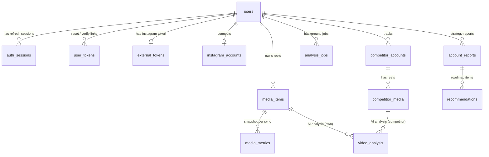

# Reelysis — Data Model

> Source of truth: `backend/app/model/*.py` (SQLModel) and `backend/alembic/versions/*.py`.
> Database: PostgreSQL (hosted on Supabase). Every table uses a UUID primary key.
> All timestamps are stored as **naive UTC** (`TIMESTAMP WITHOUT TIME ZONE`), produced by `app/utils/time.py::utc_now()`.

---

## 1. Entity-relationship diagram

In plain words:

- A **user** signs up with email + password; emailed reset/verification links live in **`user_tokens`**.
- They connect **one Instagram account** (`instagram_accounts`) and we store their **encrypted Meta token** (`external_tokens`).
- Every sync pulls their Reels into **`media_items`** and appends a fresh **metrics snapshot** to **`media_metrics`** (so we can compute growth over time).
- We track up to 10 **competitors** (`competitor_accounts`) and store up to 5 of their reels each (`competitior_media` — note the typo, it is the real table name).
- AI output for any video (own or competitor) goes to **`video_analysis`**.
- Every long-running action is tracked as a row in **`analysis_jobs`** so the frontend can poll progress.
- The final strategy document lives in **`account_reports`**, and its actionable to-do items in **`recommendations`**.

---

## 2. Tables

### 2.1 `users`
| Column | Type | Notes |
|---|---|---|
| id | UUID PK | `uuid4()` |
| email | varchar, **unique** | validated as `EmailStr` |
| name | varchar | |
| password_hash | varchar | bcrypt via passlib |
| email_verified_at | timestamp, nullable | `NULL` = unverified (banner shown). Users created before Nov 2026 were set to `created_at` by migration `c3d4e5f6a7b8` |
| created_at | timestamp | |

### 2.2 `auth_sessions` — refresh-token store
| Column | Type | Notes |
|---|---|---|
| id | UUID PK | |
| user_id | UUID FK → users (CASCADE) | |
| refresh_token_hash | varchar | **SHA-256** hex of the full refresh JWT (never the raw token) |
| expires_at | timestamp | now + 30 days |
| revoked_at | timestamp, nullable | set on refresh (rotation), logout, password reset/change, and token-reuse detection |

One row per logged-in device. The refresh JWT carries this row's `id` as its `sid` claim, so refresh looks the row up directly and compares hashes.

Why hash the refresh token? If the DB leaks, attackers cannot replay refresh tokens. Why SHA-256 and not bcrypt? The token is long and random, so a fast hash is safe — and bcrypt only reads the first 72 bytes, which for JWTs is the same for every token of a user (the original v1 bug: any old token matched).

### 2.2b `user_tokens` — emailed single-use links
| Column | Type | Notes |
|---|---|---|
| id | UUID PK | |
| user_id | UUID FK → users (CASCADE), indexed | |
| purpose | varchar | `password_reset` (30 min) or `email_verify` (48 h) |
| token_hash | varchar, indexed | SHA-256 of the token in the link |
| expires_at | timestamp | |
| used_at | timestamp, nullable | set when consumed, or when a newer link for the same purpose is issued |
| created_at | timestamp | |

### 2.3 `external_tokens` — Instagram (Meta) credentials
| Column | Type | Notes |
|---|---|---|
| id | UUID PK | |
| user_id | UUID FK → users, indexed | one per user (enforced in code, not by a unique constraint) |
| encrypted_access_token | varchar | **Fernet**-encrypted long-lived IG token (`TOKEN_ENCRYPTION_KEY`) |
| encrypted_refresh_token | varchar, nullable | unused (Instagram long-lived tokens are *refreshed*, not paired with a refresh token) |
| expires_at | timestamp | from Meta `expires_in` (≈ 60 days); extended by the daily refresh task; set to *now* when Meta reports the token invalid → `needs_reconnect` |
| scopes | varchar[] | `instagram_business_basic`, `instagram_business_manage_insights` |

Why encrypt (not hash)? We need the original token back to call the Instagram API, so it must be reversible. Hashing is one-way.

### 2.4 `instagram_accounts`
| Column | Type | Notes |
|---|---|---|
| id | UUID PK | |
| user_id | UUID FK → users | one per user (code-enforced) |
| instagram_user_id | varchar | Meta's IG user id |
| username | varchar | |
| account_type | enum `accounttype` (`BUSINESS`, `CREATOR`) | Personal accounts cannot use the Graph API |
| profile_picture_url, biography | varchar, nullable | |
| niche_detected | varchar, nullable | AI guess (Gemini) |
| niche_confirmed | varchar, nullable | what the user confirmed in onboarding/settings — drives competitor discovery |
| followers_count, media_count | int | |
| last_synced_at | timestamp, nullable | `NULL` = never synced (frontend uses this to decide onboarding state) |

### 2.5 `media_items` — the user's own posts/reels
| Column | Type | Notes |
|---|---|---|
| id | UUID PK | |
| user_id | UUID FK → users | |
| external_media_id | varchar | Instagram media id (upsert key together with `user_id`) |
| media_type | varchar | `VIDEO` (Reels). Since Nov 2026 only videos are imported and older image/carousel rows are deleted on sync |
| caption | varchar | |
| hashtag | JSONB | `{"names": ["tag1", ...]}` parsed from caption |
| permalink, thumbnail_url | varchar | thumbnail falls back to `media_url` for images |
| audio_url | varchar | the video `media_url` → sent to AssemblyAI (added in migration `a1b2c3d4e5f6`) |
| transcript_text | varchar | |
| transcript_source | varchar | `none` / `assemblyai` / `simulation` / `provider` |
| published_at | timestamp | from IG `timestamp` |

### 2.6 `media_metrics` — append-only performance snapshots
| Column | Type | Notes |
|---|---|---|
| id | UUID PK | |
| media_item_id | UUID FK → media_items (CASCADE) | |
| view, reach, likes, saves, shares, total_interactions | int | from IG Insights (`views`, `reach`, `likes`, `saved`, `shares`, `total_interactions`) |
| comments | **varchar** | stored as a string (schema quirk) |
| raw_metrics | JSONB | the parsed insights dict, for debugging |
| captured_at | timestamp | sync time |

**Design choice:** a new row is inserted on *every* sync rather than updating one row. That is what makes the growth chart and "% change vs last sync" possible (time-series). The cost is table growth and the need to "pick latest per reel" in queries.

### 2.7 `competitor_accounts`
| Column | Type | Notes |
|---|---|---|
| id | UUID PK | |
| user_id | UUID FK → users | competitors are **per user**, not global |
| provider | varchar | always `brightdata` |
| handle, display_name | varchar | |
| profile_picture_url | varchar, nullable | added in migration `0b5d73cbc460` |
| followers_count, media_count | int | |
| niche_tags | JSONB | unused |
| engagement_rank | int | engagement rate in **basis points** (0.0455 → 455 = 4.55%) — see `utils/competitor_metrics.py` |
| source_metadata | JSONB | `{"source": "manual"}` or `{"source": "auto_discovery", "follower_tier": 10000}` |
| last_synced_at | timestamp | used for the 7-day freshness rule before reports |

### 2.8 `competitior_media` (sic) — competitor reels
| Column | Type | Notes |
|---|---|---|
| id | UUID PK | |
| user_id | UUID FK → users | |
| competitor_account_id | UUID FK → competitor_accounts (CASCADE) | |
| provider_media_id | varchar, nullable, indexed | Bright Data post id/shortcode — dedupe key together with `permalink` (was a never-filled UUID before migration `c3d4e5f6a7b8`) |
| media_type, caption, permalink, thumbnail_url, audio_url | varchar | |
| hashtags | JSONB | `{"names": [...]}` |
| transcript_text, transcript_source | varchar | |
| metrics | JSONB | `{"views", "likes", "comments"}` |
| published_at | timestamp | parsed from `date_posted` / `timestamp` / `taken_at`; falls back to fetch time |

### 2.9 `video_analysis` — Gemini output (own **or** competitor)
| Column | Type | Notes |
|---|---|---|
| id | UUID PK | |
| user_id | UUID FK → users | |
| media_source | enum (`own`, `competitor`) | |
| media_item_id | UUID FK → media_items, nullable | set when `own` |
| competitor_media_id | UUID FK → competitior_media, nullable | set when `competitor` |
| topic, category, content_pillar | varchar | |
| hook_score | int 0–100 | normalised by `utils/scoring.py` |
| confidence | int 0–100 | capped ≤ 65 when there is no transcript |
| engagement_score | int 0–100 | `interactions / views * 100`, capped |
| analysis_detail | JSONB | the full `VideoAnalysisResponse` (hook text, pacing, visual style, strengths, weaknesses) |
| created_at | timestamp | |

This is a **polymorphic association**: one table, two nullable FKs, and an enum telling you which is set.

### 2.10 `analysis_jobs` — background job tracker
| Column | Type | Notes |
|---|---|---|
| id | UUID PK | returned to the frontend as `job_id` |
| user_id | UUID FK → users | ownership check on polling |
| job_type | varchar | `instagram_sync`, `competitor_discovery`, `transcription`, `video_analysis`, `report_generation` |
| status | varchar | `queued` → `running` → `succeeded` / `failed` |
| progress | int 0–100 | written by the worker as it goes (`job_utils.set_progress`) |
| input_payload | JSONB | e.g. `{"niche": ..., "mode": ..., "snapshot_id": ..., "suggested_handles": [...]}` |
| result_payload | JSONB | unused |
| error_message | varchar | user-facing failure reason |
| retry_count | int | number of re-dispatches of a queued sync (max 3) |
| started_at, completed_at | timestamp | default to **Unix epoch (1970)** meaning "not set" — code checks `year <= 1971` |
| created_at, updated_at | timestamp | `updated_at` doubles as the worker **heartbeat**: bumped on every progress update; a running job with no heartbeat for 15 min is failed by the reconciler |

The database row — not Celery's own result backend — is the source of truth the UI polls. That is a deliberate choice: it survives worker restarts and is queryable with SQL.

### 2.11 `account_reports`
| Column | Type | Notes |
|---|---|---|
| id | UUID PK | |
| user_id | UUID FK → users | |
| title | varchar | `"Growth Strategy - <Month YYYY>"` |
| status | varchar | `ready` |
| summary | varchar | |
| report_json | JSONB | full `StrategicReportResponse` (trends, competitor strengths, gaps, advantages, roadmap) |
| report_markdown | varchar | long-form report rendered by the frontend with `react-markdown` |
| created_at, updated_at | timestamp | |

### 2.12 `recommendations`
| Column | Type | Notes |
|---|---|---|
| id | UUID PK | |
| user_id | UUID FK → users | |
| account_report_id | UUID FK → account_reports (CASCADE) | |
| recommedation_type (sic) | varchar | `hook`, `topic`, `pacing`, `format` … |
| title, description, evidence | varchar | |
| priority | int | 1–5 (5 = highest) |
| status | varchar | `pending` ↔ `completed` (toggled by `PATCH /analysis/report/roadmap/{id}`) |

---

## 3. Migrations

| Revision | Parent | What it does |
|---|---|---|
| `e78674adcf4d` | — (base) | Creates all 12 tables |
| `0b5d73cbc460` | `e78674adcf4d` | Adds `competitor_accounts.profile_picture_url` |
| `a1b2c3d4e5f6` | `0b5d73cbc460` | Adds `media_items.audio_url` |
| `c3d4e5f6a7b8` | `a1b2c3d4e5f6` | Adds `users.email_verified_at` (existing users marked verified), creates `user_tokens`, revokes all existing refresh sessions (old bcrypt hashes can't be verified), changes `competitior_media.provider_media_id` to varchar, adds 16 indexes on existing tables (+2 on `user_tokens`) |

All indexes are also declared on the models (`__table_args__` / `index=True`), so `alembic check` reports no drift.

Indexes added in `c3d4e5f6a7b8`: `auth_sessions(user_id)`, `external_tokens(user_id)`, `instagram_accounts(user_id)`, `media_items(user_id, published_at)`, `media_items(user_id, external_media_id)`, `media_metrics(media_item_id, captured_at)`, `competitor_accounts(user_id)`, `competitior_media(competitor_account_id)`, `competitior_media(user_id)`, `competitior_media(provider_media_id)`, `video_analysis(user_id, media_source)`, `video_analysis(media_item_id)`, `video_analysis(competitor_media_id)`, `analysis_jobs(user_id, job_type, created_at)`, `account_reports(user_id, created_at)`, `recommendations(account_report_id)`, plus `user_tokens(user_id)` and `user_tokens(token_hash)`.

Run with `python backend/scripts/run_migrations.py` (Render runs it as `preDeployCommand`). The API can also auto-migrate on startup when `RUN_MIGRATIONS_ON_STARTUP=true` (the default — production turns it off).

---

## 4. Redis keys (the "other" datastore)

Redis is not just the Celery broker; the app stores several things in it:

| Key pattern | TTL | Written by | Purpose |
|---|---|---|---|
| `oauth_state:{state}` | 10 min | `instagram_service.get_oauth_url_service` | maps OAuth `state` → `user_id` (CSRF protection + "who is this callback for?") |
| `gemini_usage:{YYYY-MM-DD}` | 2 days | `ai_service.reserve_gemini_call` | daily Gemini call counter (budget guard); the date is **Pacific time**, matching Google's quota reset; if Redis is unavailable the guard fails closed |
| `gemini_rpm:{minute}` | 120 s | `ai_service._throttle_gemini_rpm` | per-minute call counter (rate limiter) |
| `competitor_handles:{niche}[:{username}]` | 7 days | `ai_service._cache_competitor_handles_sync` | cache of Gemini competitor suggestions |
| `avatar:competitor:{id}:bytes` / `:type` | 7 days | `utils/cdn_image.py` | cached competitor profile-picture bytes |
| `LIMITS:*` | per window | slowapi | HTTP rate-limit counters |
| `default`, `slow`, `celery-task-meta-*`, `_kombu*` | — | Celery | the two task queues + results |

---

## 5. Schema quirks worth knowing

- Typos baked into the schema: table `competitior_media`, column `recommedation_type`. Kept for API compatibility; renaming needs a migration *and* frontend type changes.
- `media_metrics.comments` is a string while every other count is an int (kept for compatibility).
- No unique constraint on `instagram_accounts.user_id`, `external_tokens.user_id`, or `media_items(user_id, external_media_id)`; uniqueness is enforced in code (now indexed, so the lookups are fast).
- `updated_at` is declared as `Column(onupdate=utc_now)` without a type; it works, but Alembic notes it can't compare the type.
