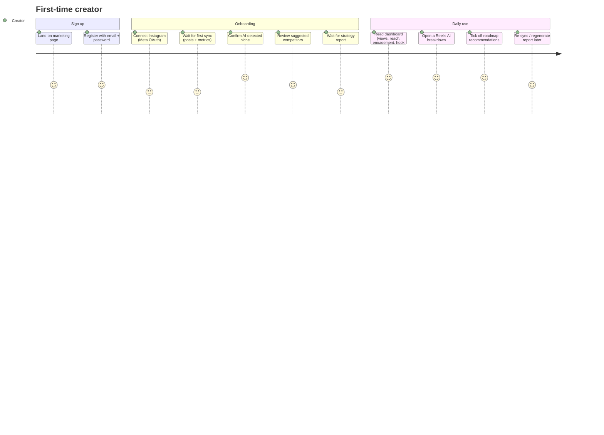

# Reelysis — Product Requirements Document (PRD)

> Reconstructed from the shipped code (Nov 2026) and updated after the Nov 2026 fix pass, which built the missing P1 features below. Where the code and this document disagree, the code wins; open gaps are in `CHALLENGES_AND_KNOWN_ISSUES.md §3`.

| | |
|---|---|
| **Product** | Reelysis — Instagram Reels growth analyzer |
| **Owner** | Bonson Alo (solo: product, design, backend, frontend, DevOps) |
| **Status** | v1 shipped (Vercel + Render + Supabase); v1.1 (fixes + account features, tests, CI) ready locally; production offline / needs revival |
| **Live URL (historical)** | https://reelysis-zeta.vercel.app |

---

## 1. One-line pitch

**Reelysis tells Instagram creators *why* their Reels perform the way they do, compares them with similar creators in their niche, and gives them a concrete to-do list for the next 30 days.**

## 2. Problem

Instagram Insights shows *what* happened (views, reach, likes) but never *why*. To find out, a creator has to:

1. Watch their own Reels again and guess what worked.
2. Manually find competitors in the same niche.
3. Watch competitors' Reels and take notes.
4. Turn all of that into a plan.

That takes hours, is inconsistent, and most small creators simply don't do it.

## 3. Target users

| Persona | Description | What they want |
|---|---|---|
| **Growing creator** (primary) | 1k–100k followers, Business or Creator account, posts Reels weekly | "Why did this Reel flop?" and "What should I post next?" |
| **Small business / brand account** | Uses Reels for marketing, no in-house strategist | Competitor benchmarks and a simple plan |
| **Social media freelancer** | Manages a client account | A shareable, evidence-backed strategy report |

Out of scope: Personal (non-professional) Instagram accounts — Meta's API does not allow them.

## 4. Goals and non-goals

**Goals (v1)**
- G1. Connect an Instagram Business/Creator account in under 1 minute via official OAuth.
- G2. Import the creator's recent posts and their performance metrics automatically.
- G3. Detect the creator's niche with AI and let them confirm/edit it.
- G4. Find 5–10 relevant competitors (≥10k followers, ≥20 posts) automatically, plus manual add.
- G5. Analyse Reels "transcript-first" (what is *said*, not just the caption): hook, topic, pillar, pacing, strengths, weaknesses.
- G6. Produce a comparative strategy report with a prioritised 30-day roadmap the user can tick off.
- G7. Run on free/cheap tiers (Gemini free tier = 20 calls/day) without breaking.

**Non-goals (v1)**
- Posting or scheduling content.
- Analysing the actual video frames (vision). Analysis is text-based: transcript + caption + hashtags + metrics.
- Multi-account / team workspaces.
- Payments or subscriptions.
- Real-time analytics (data refreshes only when the user syncs).

## 5. User journey (happy path)

## 6. Features & requirements

Priority: **P0** = must have for v1, **P1** = should have, **P2** = nice to have.

### 6.1 Account & authentication
| ID | Requirement | Priority | Shipped |
|---|---|---|---|
| A1 | Sign up with name, email, password (strength rules) | P0 | ✅ |
| A2 | Log in / log out | P0 | ✅ |
| A3 | Stay logged in for up to 30 days (refresh token) | P0 | ✅ |
| A4 | Tokens never readable by JavaScript (HttpOnly cookies) | P0 | ✅ |
| A5 | Brute-force protection (rate limits on auth) | P1 | ✅ |
| A6 | Password reset by emailed link (30 min, single use, signs out everywhere) | P1 | ✅ |
| A6b | Email verification (48 h link, resend; soft — banner, not a block) | P1 | ✅ |
| A6c | Change password (signs out other devices) | P1 | ✅ Settings → Security |
| A6d | Delete account (password confirmation, deletes all data) | P1 | ✅ Settings → Profile |
| A7 | Settings: profile, Instagram, security tabs | P1 | ✅ (2FA still "coming soon") |

### 6.2 Instagram connection & sync
| ID | Requirement | Priority | Shipped |
|---|---|---|---|
| I1 | Connect via official Instagram OAuth (Business/Creator) | P0 | ✅ |
| I2 | Store the Instagram token encrypted | P0 | ✅ Fernet |
| I3 | Import Reels: caption, hashtags, type, permalink, thumbnail, video URL, publish time | P0 | ✅ paginated, up to 50 most recent videos/Reels |
| I4 | Import per-post insights: views, reach, likes, comments, saves, shares, total interactions | P0 | ✅ |
| I5 | Keep history of metrics across syncs (growth over time) | P0 | ✅ snapshots |
| I6 | Manual "Sync now" with live progress | P0 | ✅ |
| I7 | Disconnect and delete all Instagram-derived data | P0 | ✅ hard delete |
| I8 | Automatic daily sync | P1 | ✅ Celery beat, hourly check for accounts not synced in 24 h |
| I9 | Auto-refresh the 60-day Instagram token; prompt to reconnect when it's dead | P1 | ✅ daily refresh within 10 days of expiry + reconnect banner |

### 6.3 Niche
| ID | Requirement | Priority | Shipped |
|---|---|---|---|
| N1 | AI detects niche from bio + captions + top hashtags | P0 | ✅ Gemini |
| N2 | User confirms or edits niche during onboarding | P0 | ✅ |
| N3 | User can change niche later and optionally re-discover competitors | P1 | ✅ |

### 6.4 Competitors
| ID | Requirement | Priority | Shipped |
|---|---|---|---|
| C1 | Auto-discover competitors for the confirmed niche | P0 | ✅ Gemini suggests handles → Bright Data verifies |
| C2 | Quality bar: ≥10,000 followers and ≥20 posts | P0 | ✅ |
| C3 | Store max 10 competitors; deep-fetch reels for top 5 (5 reels each) | P0 | ✅ |
| C4 | Manually add/remove a competitor by handle | P0 | ✅ |
| C5 | Show avatar, followers, posts, engagement rate | P1 | ✅ (avatar proxied + cached) |
| C6 | "Refresh suggestions" (re-run discovery, keep manual ones) | P1 | ✅ |

### 6.5 AI video analysis
| ID | Requirement | Priority | Shipped |
|---|---|---|---|
| V1 | Transcribe Reel audio (AssemblyAI) | P0 | ✅ |
| V2 | Gemini analysis → topic, category, content pillar, hook text, hook score 0–100, pacing, visual style, strengths, weaknesses, confidence 0–100 | P0 | ✅ structured JSON output |
| V3 | Lower confidence when there is no transcript | P1 | ✅ capped at 65 |
| V4 | Per-video detail page with metrics + analysis | P0 | ✅ |
| V5 | Stay inside the Gemini free tier | P0 | ✅ budget + RPM throttle; only 2 own + 3 competitor videos per report |

### 6.6 Dashboard
| ID | Requirement | Priority | Shipped |
|---|---|---|---|
| D1 | KPI cards: total views, avg reach, avg engagement, top hook score — each with change vs previous sync | P0 | ✅ |
| D2 | 30-day growth chart (views & reach) | P1 | ✅ needs ≥2 sync days to be meaningful |
| D3 | Content-pillar breakdown (count + avg engagement) | P1 | ✅ |
| D4 | Recent Reels grid with hook score & engagement | P0 | ✅ |
| D5 | Clear processing/empty states while jobs run | P0 | ✅ |

### 6.7 Strategy reports
| ID | Requirement | Priority | Shipped |
|---|---|---|---|
| R1 | Generate a report comparing user vs competitors | P0 | ✅ |
| R2 | Report contains: summary, market trends, competitor strengths, user gaps, user advantages, long-form markdown | P0 | ✅ |
| R3 | 3–5 prioritised recommendations with evidence | P0 | ✅ |
| R4 | Mark recommendations done / not done | P1 | ✅ toggle |
| R5 | Report history list + detail page | P1 | ✅ |
| R6 | Export to PDF | P2 | ✅ "Export PDF" → browser print dialog with a print stylesheet ("Save as PDF"); full Unicode, no server dependency |

## 7. Success metrics (how we would measure v1)

| Metric | Target |
|---|---|
| Signup → Instagram connected | ≥ 60% |
| Connected → first report generated | ≥ 70% |
| Report generation success rate | ≥ 90% (failures today are mostly quota/timeouts) |
| Median time to first report | < 10 min |
| Recommendations marked done per active user / month | ≥ 2 |
| Day-7 return rate | ≥ 30% |

None of these are instrumented yet (no analytics). Worth adding before relaunch.

## 8. Constraints & assumptions

- **Instagram API:** only Business/Creator accounts; long-lived tokens last ~60 days; insights are lifetime totals per media.
- **No official competitor API:** Instagram does not let you read other accounts' insights, so public data comes from a scraper (Bright Data). Only public counts (views/likes/comments) are available for competitors — never reach or saves.
- **Gemini free tier:** ~20 requests/day and ~5/minute for `gemini-2.5-flash`. The whole pipeline is designed around that budget.
- **Cost:** hosting must fit Render free/Starter + Supabase free + Vercel hobby.
- **Latency:** Bright Data snapshots take minutes, so everything heavy is asynchronous with progress polling.

## 9. Risks

| Risk | Impact | Mitigation in v1 |
|---|---|---|
| Gemini quota exhausted mid-report | Report fails | Daily budget counter, reserve 1 call for the report, small video caps, clear error message |
| Bright Data slow / missing handles | Discovery fails or returns few competitors | Ask Gemini for 15 handles, long polling (≈10 min), fallback to existing handles, manual add |
| Gemini suggests fake/wrong handles | Bad competitors | Verify every handle via Bright Data + follower/post quality bar |
| Instagram CDN blocks images | Broken avatars/thumbnails | Server-side avatar proxy + Redis cache; thumbnails via redirect |
| Worker restarts mid-job | Job stuck at "running" forever | Workers heartbeat; reconcilers fail jobs with no heartbeat for 15 min when the UI polls |
| Meta app review | Can't onboard public users | App ran in development mode with test users |

## 10. Future ideas (v2)

- Two-factor authentication.
- Same-site custom domains (avoid third-party cookie blocking).
- Vision analysis of the first 3 seconds (Gemini multimodal) for real hook scoring.
- Shareable report links; server-rendered PDF.
- "Next post" generator: script + hook + hashtags from the roadmap.
- Paid tier with higher AI budget, Stripe billing.
- Team/agency workspaces with multiple Instagram accounts.
