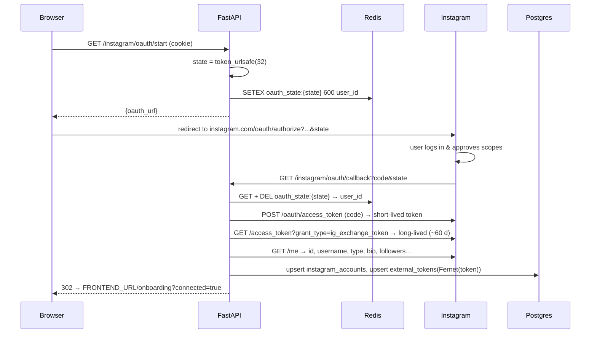
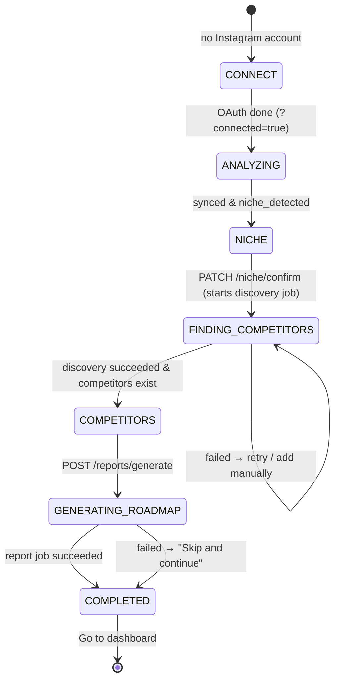
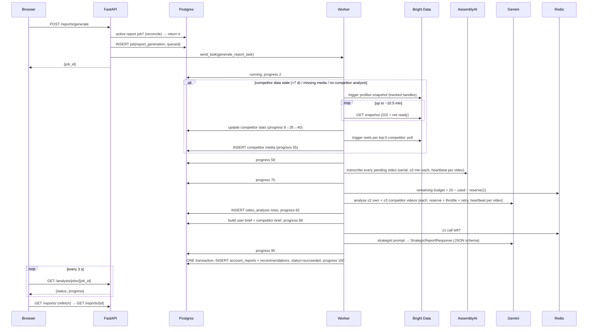
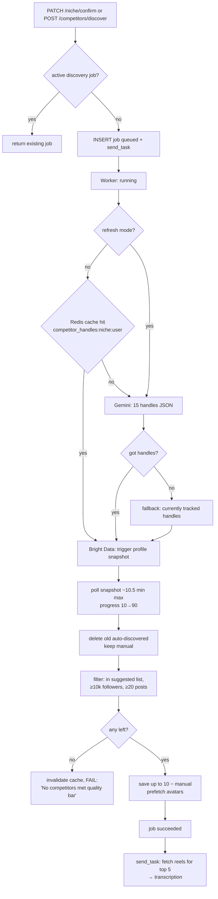
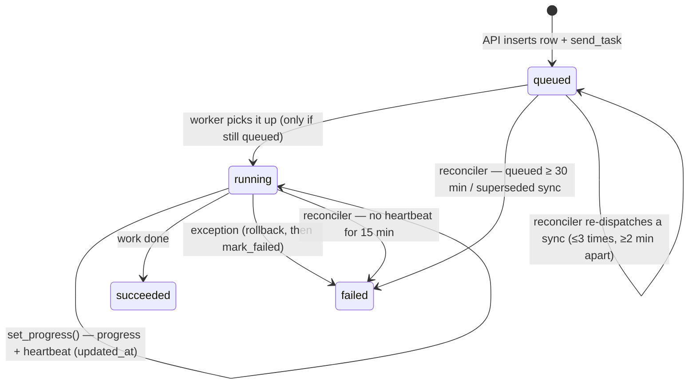
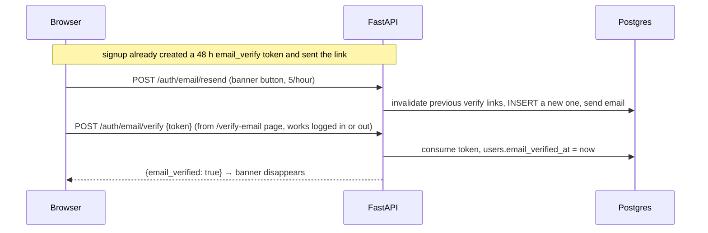
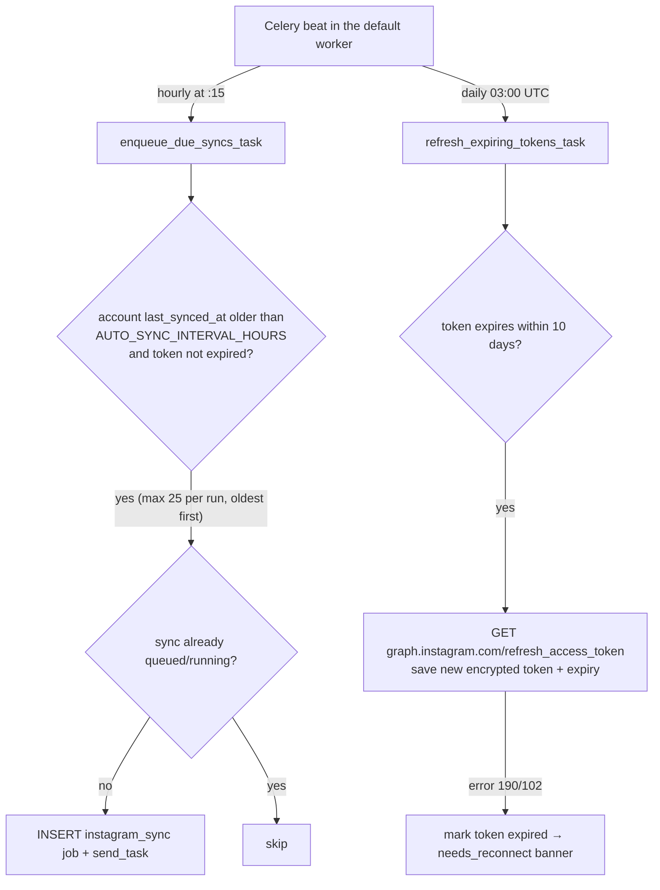

# Reelysis — Workflows

> End-to-end flows, step by step, with sequence diagrams. Each one names the files involved so you can follow along in the code.

---

## 1. Sign up / log in / stay logged in

```mermaid
sequenceDiagram
    participant B as Browser (Next.js)
    participant A as FastAPI
    participant DB as Postgres
    participant M as SMTP

    B->>A: POST /auth/signup {name,email,password}
    A->>A: validate_password_strength, bcrypt.hash (in a thread)
    A->>DB: INSERT users (email_verified_at = NULL)
    A->>DB: INSERT auth_sessions(id = sid)
    A->>A: access JWT (N min) + refresh JWT (30 d, carries sid)
    A->>DB: store sha256(refresh JWT) on that session
    A->>DB: INSERT user_tokens(email_verify, sha256(token), 48 h)
    A->>M: "Verify your Reelysis email" (link to /verify-email?token=…)
    A-->>B: 200 {id,name,email,email_verified:false,created_at} + Set-Cookie (HttpOnly)
    B->>B: Redux setUser → onboarding; dashboard shows "verify your email" banner

    Note over B,A: later… access token expired
    B->>A: GET /analysis/dashboard/stats
    A-->>B: 401
    B->>A: POST /auth/refresh (one shared request for all parallel 401s)
    A->>DB: load auth_sessions[sid]; compare sha256; not revoked; not expired
    A->>DB: revoke it, INSERT new session (new sid)
    A-->>B: 200 + new cookies
    B->>A: retry GET /analysis/dashboard/stats
    A-->>B: 200 data
```

Files: `features/auth/*`, `lib/axios.ts`, `endpoints/auth.py`, `service/auth_service.py`, `api/dep.py`, `core/cookies.py`, `core/email.py`.

**Simple version:** the login gives you two "tickets" stored in cookies JS can't read. The short ticket opens doors; when it expires the browser quietly trades the long ticket for a fresh pair. Each device has its own long ticket, each long ticket works once, and if someone tries an already-used one later, every ticket for that account is cancelled (it was probably stolen).

**Logout** revokes only the session in this browser's refresh cookie and clears cookies. The frontend also clears the React Query cache and Redux.

---

## 2. Connecting Instagram (OAuth 2.0 authorization-code flow)



Why `state`? It proves the callback belongs to a flow *we* started and tells us *which user* it's for (the callback request may not carry our cookies).

**When it goes wrong** the callback never shows raw JSON; it redirects back to the app:

| Situation | Redirect |
|---|---|
| User clicked "Cancel" / Instagram sent `error` | `/onboarding?connected=false&error=access_denied` |
| `state` missing, expired (10 min) or reused | `…&error=invalid_state` |
| Code exchange / profile fetch / DB failed | `…&error=connect_failed` (details in server logs, never the code or token) |

The onboarding Connect step turns these into friendly messages (`features/instagram/utils.getOAuthErrorMessage`). Reconnecting an existing account uses the same flow and updates the stored token.

---

## 3. Onboarding (what the user sees vs what runs)



| Step | Frontend does | Backend runs |
|---|---|---|
| ANALYZING | auto `POST /instagram/sync` once; poll accounts (2 s) + sync job (3 s); "Retry sync" / "Reconnect Instagram" on failure | `sync_instagram_data_task` → then `run_transcription_task` (slow queue) |
| NICHE | `PATCH /niche/confirm {niche}`, then refetch the discovery job so polling starts | saves niche, creates `competitor_discovery` job |
| FINDING_COMPETITORS | poll discovery job (3 s) + competitor list (3 s) | `poll_competitor_results_task` → then `fetch_competitor_media_batch_task` → transcription |
| COMPETITORS | add/remove competitors | `fetch_competitor_media_task` for manual adds (slow queue) |
| GENERATING_ROADMAP | `POST /reports/generate`, poll job by id (3 s); moves to COMPLETED as soon as it succeeds | `generate_report_task` |

The step is re-derived from server data on every render (`app/onboarding/page.tsx` effect), so refreshing the page resumes correctly. The Nov 2026 onboarding fixes are listed in `CHALLENGES_AND_KNOWN_ISSUES.md §2.5`.

---

## 4. Instagram sync

```mermaid
sequenceDiagram
    participant B as Browser
    participant A as FastAPI
    participant DB as Postgres
    participant Q as Redis (queue "default")
    participant W as Celery worker
    participant IG as Instagram API
    participant G as Gemini

    B->>A: POST /instagram/sync
    A->>DB: fail superseded queued syncs; latest sync active? → return it
    A->>DB: INSERT analysis_jobs(instagram_sync, queued, 0)
    A->>Q: send_task(sync_instagram_data_task, [job_id, user_id])
    A-->>B: {job_id, status: queued}

    loop every 2–3 s
        B->>A: GET /analysis/jobs/{job_id}
        A->>A: reconcile (heartbeat-based, see §7)
        A-->>B: {status, progress}
    end

    Q->>W: task (skipped unless the job is still "queued")
    W->>DB: status=running
    opt token expires within 10 days
        W->>IG: GET /refresh_access_token → save new encrypted token
    end
    W->>IG: GET /me (refresh profile)
    W->>DB: progress 5
    W->>IG: GET /me/media (follow paging.next, up to 50 items)
    W->>DB: delete old non-video rows; keep only videos/Reels
    loop each Reel
        W->>IG: GET /{id}/insights
        W->>DB: upsert media_items (user_id + id), INSERT media_metrics, progress 5→95 (heartbeat)
    end
    alt niche not confirmed
        W->>G: detect niche (budget + RPM guarded), progress 95→100
    end
    W->>DB: last_synced_at, status=succeeded, progress=100
    W->>Q: send_task(run_transcription_task) → queue "slow"
```

If Meta answers with error code 190/102 (token expired or revoked), the job fails with "Instagram access expired. Please reconnect your Instagram account.", the stored token is marked expired, and `GET /instagram/accounts` returns `needs_reconnect: true` → the dashboard and Settings show a reconnect banner.

---

## 5. Strategy report generation (the big one)



**What goes into the final prompt:**

```json
USER DATA:       {"video_count", "top_topics"[≤5], "average_hook_score", "dominant_category"}
COMPETITOR DATA: {"competitor_video_count", "winning_topics" (hook ≥ 80), "market_avg_hook_score", "successful_formats" (hook ≥ 70)}
```

**Failure modes and the message the user sees**

| Cause | Message |
|---|---|
| Daily Gemini budget used up | "Gemini API daily quota reached…" / "No Gemini budget left today for the final report…" |
| Per-minute limit after 5 retries | "Gemini rate limit reached… Wait about a minute" |
| Gemini 503 | "Gemini is temporarily unavailable due to high demand" |
| Bright Data slow | "Timed out waiting for competitor profiles before report generation" |
| Worker down / asleep (queued ≥30 min) | "Report timed out before starting. Wake the worker and try again." |
| Worker died mid-task (no heartbeat for 15 min) | "Report generation was interrupted. Please try again." |

---

## 6. Competitor discovery



---

## 7. Job lifecycle & reconciliation



Code: `service/job_utils.py` (`set_progress`, `mark_running/succeeded/failed`, `job_should_start`, `reconcile_job`, `heartbeat_sync`).

| Job type | Queued → re-dispatch | Queued → failed | Running → failed |
|---|---|---|---|
| `instagram_sync` | after 2 min, max 3 times, 2 min apart | 30 min (or superseded by a newer finished sync) | 15 min without heartbeat |
| `competitor_discovery`, `report_generation` | — | 30 min | 15 min without heartbeat |
| `transcription`, `video_analysis` | — | 30 min | 15 min without heartbeat |

Why heartbeats? v1 judged "stuck" by time since **start** (2 min for sync, 10 min for reports), which was shorter than a real slow run, so live jobs were failed and then flipped back to succeeded when the worker finished. Now a job is only failed when the worker has been silent for 15 minutes — longer than any single external call or Gemini throttle wait, and well inside Celery's 1-hour hard limit.

Reconcilers run **only when someone reads the job** (polling and trigger endpoints) — there is no background sweeper.

---

## 8. Password reset

```mermaid
sequenceDiagram
    participant B as Browser
    participant A as FastAPI
    participant DB as Postgres
    participant M as SMTP

    B->>A: POST /auth/password/forgot {email}
    alt account exists
        A->>DB: mark earlier unused reset tokens used
        A->>DB: INSERT user_tokens(password_reset, sha256(token), 30 min)
        A->>M: email with /reset-password?token=…
    end
    A-->>B: 200 "If an account exists for that email, a reset link has been sent." (same either way)

    B->>A: POST /auth/password/reset {token, password}
    A->>A: validate strength
    A->>DB: find token by sha256, unused, unexpired → mark used
    A->>DB: new bcrypt hash; email_verified_at = now if NULL; revoke ALL sessions
    A-->>B: 200 + clear cookies
    B->>B: clear React Query + Redux → /login?reset=1 ("Password updated")
```

**Change password** (Settings → Security): `POST /auth/password/change {current_password, new_password}` → verify current → new hash → revoke all sessions → issue a fresh session for this device. Other devices are signed out at their next refresh.

**Delete account** (Settings → Profile): `DELETE /auth/account {password}` → verify → `DELETE FROM users` (every owned table cascades) → clear cookies → frontend reloads to `/`.

## 9. Email verification



Verification is "soft": unverified users can use everything; they just see the banner.

## 10. Daily sync & token refresh (Celery beat)



Accounts that were never synced are left to onboarding. Turn the scheduler off with `AUTO_SYNC_ENABLED=false`.

---

## 11. Disconnect Instagram

`DELETE /instagram/disconnect` → in one transaction delete: recommendations → reports → video analyses → media items (cascades metrics) → competitor media → competitors → jobs → external token → instagram account. The user account and login sessions remain. Frontend sets `instagram-accounts` cache to `[]` and invalidates 13 query prefixes.

---

## 12. Developer workflow

1. Run Postgres + Redis, API (`uvicorn --reload`), workers + beat (`scripts/worker.sh`), frontend (`pnpm dev`).
2. Use `AI_SIMULATION_MODE=true` for UI work (no API costs, deterministic data).
3. Schema change: edit `app/model/*.py` → `cd backend && alembic revision --autogenerate -m "..."` → review the file → `python scripts/run_migrations.py`.
4. Tests: `cd backend && python -m pytest -q` (needs the test Postgres on 5433 and Redis on 6380 — see `SETUP_AND_ENVIRONMENT.md`); frontend `pnpm exec tsc --noEmit && pnpm lint && pnpm build`. CI runs both on every push.
5. Switching from simulated to real AI data: `python scripts/real_mode_resync.py [--user-id <uuid>] [--dry-run]`.
6. Deploy: push → Vercel builds frontend; Render runs migrations (pre-deploy) then restarts API and worker.
